<div align="center">

# agent-jury

**A review loop that ends.**

[](LICENSE)
[](#install)
[](package.json)
[](#install)

[Install](#install) ·
[How a run looks](#how-a-run-looks) ·
[The three rules](#the-three-rules) ·
[Recorded run](examples/convergence/) ·
[Without a shell](USE-ANYWHERE.md)


<picture>
  <source media="(prefers-color-scheme: light)" srcset="assets/hero-light.svg">
  
</picture>

</div>

You ask a model to review a draft. It finds a factual error. You fix it, ask again, and
now it dislikes the tone. Fix that, ask again: the structure. Every reviewer is right in
isolation, and the loop never ends, because "good" moves every round. Or the opposite:
one reviewer says PASS and you ship something a second reader would have stopped.

agent-jury is the loop with the stop conditions built in. A fresh judge each round, a bar
that cannot rise between rounds, two independent judges before the final PASS, and
`DISPUTED` handed to a human when they disagree and the failing judge's quote cannot be
found in the file. It is a small CLI that keeps the state and enforces the rules, plus
a skill that tells an agent how to run it.

**The CLI never calls a model.** Your agent spawns the judges: a subagent in Claude Code,
a new session in Codex or Gemini CLI, a fresh chat anywhere. The judge sees the rubric
(your 3-6 pass/fail criteria), the artifact (the file under review) and, from round 2
on, what the previous round failed and passed; nothing else. The CLI validates the
reply, checks each quote against the artifact, applies the rules and tells the agent
what to do next.

## Install

**Claude Code or Cowork (Anthropic's desktop agent), as a plugin:**

```bash
/plugin marketplace add 30Elevate/agent-jury
/plugin install agent-jury@agent-jury
```

Then `/agent-jury:agent-jury` in any project.

**Codex, Gemini CLI and other agents that read the open [Agent Skills](https://agentskills.io) format:**

```bash
npx skills add 30Elevate/agent-jury
```

The skill folder carries its own copy of the CLI, so it works on its own; the install
prints where it put the folder (for example `.claude/skills/agent-jury`). Then ask your
agent to run agent-jury on a file; the skill tells it the rest. Both agent paths run
the CLI with Node 22.18 or newer, like the global install below.

**Just the CLI** (Node 22.18 or newer, no build step):

```bash
npm install -g github:30Elevate/agent-jury
agent-jury --help
```

**No shell at all** (ChatGPT, Claude.ai, Gemini in a browser): [USE-ANYWHERE.md](USE-ANYWHERE.md)
is the same protocol with the bookkeeping done by hand.

## How a run looks

```bash
# 1. A rubric: 3-6 lines, each one something the reader gets. Before the draft.
cat > rubric.md <<'EOF'
# Release notes
- facts: every version, date and command matches the changelog and the code
- complete: every change in the diff is mentioned
- plain: a reader who did not write the code understands each line
EOF

# 2. Start a run.
agent-jury init notes --rubric rubric.md --artifact draft.md --rounds 3

# 3. Round 1: print the judge prompt, give it to a fresh judge, record the JSON reply.
agent-jury prompt notes > prompt.md
agent-jury record notes --judge A --file reply.json
#   Round 1, judge A: NEEDS_WORK
#     FAIL facts: The draft says Node 20, package.json says 22.18.
#     PASS complete: ...
#     PASS plain: ...
#   Evidence check:
#     facts: evidence verified (quote found in the artifact: "Requires Node 20 or newer")
#   Fixes:
#     - facts: Change "Node 20 or newer" to "Node 22.18 or newer" in the first bullet.
agent-jury merge notes          # exit 2: fix, then round 2

# 4. Edit draft.md as the fix says. Round 2: the prompt now carries the prior objection.
agent-jury prompt notes > prompt.md
agent-jury record notes --judge A --file reply.json
#   Round 2, judge A: PASS
#   Fixed since round 1: facts
agent-jury merge notes          # exit 5: "Round 2: judge A passed. Record judge B before merging:"

# 5. Confirmation: a second fresh judge, ideally a different model.
agent-jury prompt notes --judge B > prompt-b.md
agent-jury record notes --judge B --file reply-b.json
agent-jury merge notes
#   Round 2 merged (judges A and B): PASS
#     PASS     facts: both judges passed it
#     ...
#   PASS after 2 round(s). Final verdict: <your folder>/.agent-jury/notes/verdict.json
```

The `#` lines are abridged; the CLI also says what to run next after `init`, `record`
and `merge`. Pass the judge's reply with `--file` rather than a pipe: on Windows, piping
through PowerShell can mangle non-ASCII text, and the CLI warns when that happened.

`agent-jury` above is the global install. After `npx skills add` the same tool is
`node <skill folder>/scripts/cli.ts`; from a clone it is `node src/cli.ts`.

Exit codes are the protocol: `0` PASS, `2` fix and go again, `5` judge B still needed,
`3` DISPUTED, `4` round limit reached, `1` bad input. The run's files live in
`.agent-jury/<run>/` (add it to `.gitignore`). Paths are stored relative to the folder
you ran the command in (or `--dir`), so a run folder can be shared without exposing your
file system; a file outside that folder is stored as an absolute path.

## The three rules

**1. Anti-ratchet.** From round 2 on, the judge receives last round's objections and the
list of criteria that passed. It may fail a criterion that passed before **only with
evidence the tool can find**: `record` looks for the judge's quote (at least 12
characters) in the artifact. A line number or a single word is not evidence. An
objection with no quote the tool can find is moved to the `optional` list (notes for the
author that do not block, see rule 2), the
criterion stays PASS, and `record` prints what it blocked and why. The bar does not rise
between rounds. This is enforced in code, not by asking nicely.

**2. The reviewer's boundary.** Only two things block: a correctness gap, or a rubric
criterion that is not met. Style, taste and "could be better" go under `optional`. They
are kept, shown to the author, and never change the verdict. If style matters, it goes
into the rubric before the run, not into the verdict during it.

**3. Two independent judges, merged without a third.** When judge A passes, judge B sees
the same artifact in a fresh context, ideally a different model, without A's verdict for
this round (from round 2 on it sees the previous round's objections, as every judge
does). The CLI merges per criterion:

| Judge A | Judge B | Result |
|---|---|---|
| PASS | PASS | PASS |
| FAIL | FAIL | FAIL |
| PASS | FAIL, quote found in the artifact | FAIL, the author can check the quote |
| PASS | FAIL, no evidence the tool can find | **DISPUTED**, a human decides |

Any FAIL means another round. DISPUTED closes the run with both reasons on the table.
The tool never picks a side and never spawns a tie-breaker; a third model would be a
third opinion. Rule 1 applies to judge B too: from round 2 on, a FAIL without a quote
the tool can find, on a criterion that passed in the previous round, is moved to
`optional` and counts as PASS. So DISPUTED arises in round 1, or on a criterion that
failed in the previous round.

The full protocol, the verdict schema and the judge prompt:
[skills/agent-jury/references/protocol.md](skills/agent-jury/references/protocol.md).
Example rubrics for text, code and design:
[skills/agent-jury/references/rubrics/](skills/agent-jury/references/rubrics/).

## Does it converge?

[examples/convergence/](examples/convergence/) is a recorded run on this project's own
release notes, with real judges and their replies as received: three rounds, run twice
from the same draft. With the anti-ratchet rule (rule 1) the objections went 4, 1, 0;
without it, 4, 2, 3,
and the round-3 judge reopened a criterion it had passed in round 2. Read it before you
trust the loop with something that matters; it also says what the run does not prove,
including two real defects that the judge without the rule caught and the judges with
the rule let through.

The rules themselves are covered by `npm test` (`node:test`, no extra tooling),
including a simulated judge that invents one new objection every round: three
objections recorded as FAIL without the rule, zero with it.

## What it is not

- Not a model router or an API client. It writes prompts and reads JSON. You bring the judges.
- Not a style guide. Style is `optional` by design; put it in the rubric if it must block.
- Not a replacement for a human on DISPUTED or on the round limit. Those are the two
  places the protocol stops on purpose.
- Not a sanitizer. The artifact goes into the judge prompt as it is. The prompt tells the
  judge that the artifact is data, not instructions, but a model with tools can still be
  talked into something by a text it reads. For an artifact you do not trust (a pull
  request from a stranger), give the judge no tools, or read the artifact yourself first.

## For agents

[AGENTS.md](AGENTS.md) has the rules for running the protocol and for editing this repo.
`src/` is the source of truth; `skills/agent-jury/scripts/` is a copy kept in step by
`node scripts/sync-skills.mjs --check`.

## License

MIT. Built by [30Elevate](https://30elevate.com), an AI agency for small and medium
businesses. If this loop saves you a round, say so in an issue; if it did not end, open
one with the run folder attached (it holds your rubric, the judges' replies and the
artifact's path and hash, nothing else from your machine).
